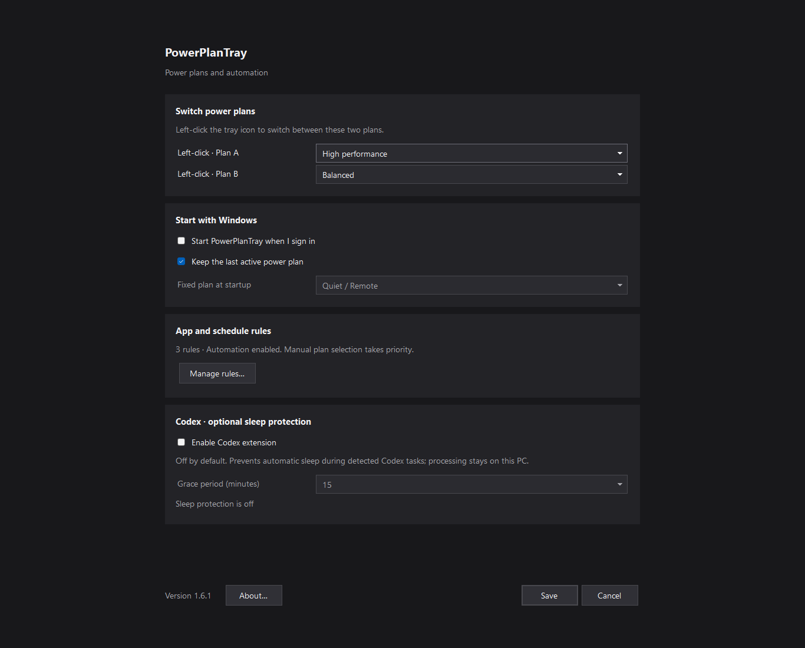
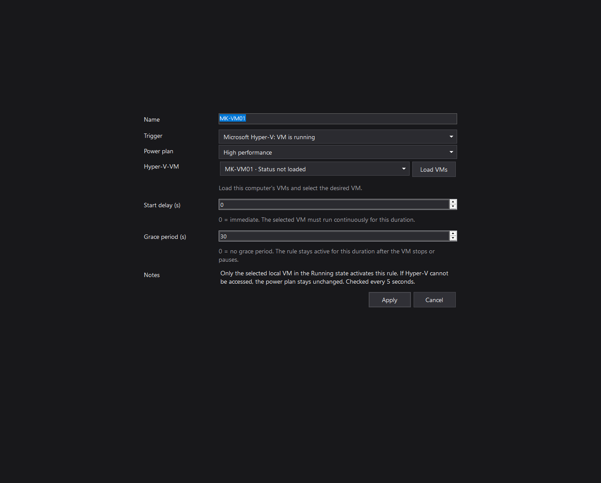

# PowerPlanTray

[Deutsch](README.md) · English

PowerPlanTray switches Windows power plans from the system tray and automatically follows app, schedule, and individual Microsoft Hyper-V VM rules.

The interface follows your Windows display language: German for German Windows display languages, English otherwise. Power-plan names and your own rule and VM names remain unchanged.

## Usage

- Right-click the tray icon to select a power plan, manage rules, or open Settings.
- Left-click to switch between the two plans selected in Settings.
- App rules match an EXE name and support a start delay and grace period.
- Schedule rules support weekdays and overnight windows. Overnight windows belong to the starting day.
- Select **Microsoft Hyper-V: VM is running**, choose **Load VMs**, then pick a local VM. Its unique ID keeps the rule associated after a rename. Hyper-V management permission is required.
- The first matching rule wins. The previous plan is restored after the last rule ends. A manual plan change pauses automation.
- The optional Codex sleep-protection extension is off by default. When disabled, its tray-menu entries are hidden.

Rules are checked at approximately five-second intervals. Schedules do not wake the PC. Power-plan changes affect the Windows host. Close an older running instance before installing an update or launching another edition.

## Downloads

Latest stable release: **[1.6.2](https://github.com/kulmi84/PowerPlanTray/releases/tag/v1.6.2)**. The older [local MSIX test package 1.6.0-beta.9](https://github.com/kulmi84/PowerPlanTray/releases/tag/v1.6.0-beta.9) includes the installer, instructions, public test certificate, and source code. Known CPU/tray delays and the differing embedded build commit are documented on its release page.

Version 1.6.2 fixes excessive Codex-monitor CPU use and the tray menu requiring additional right-clicks. [Changes and installation notes](docs/releases/1.6.2.md).

[GitHub releases](https://github.com/kulmi84/PowerPlanTray/releases) contain portable Windows x64 ZIPs. The standard edition contains no Codex session watcher; the Codex edition includes optional sleep protection. The Microsoft Store edition is being prepared separately and includes the optional extension, off by default.

## Privacy and support

Data is processed locally. See the [privacy notice](docs/PRIVACY.en.md) and [component notices](docs/COMPONENTS.en.md). Report bugs or suggest improvements through [GitHub Issues](https://github.com/kulmi84/PowerPlanTray/issues).

Developed by Marcin Kulmaczewski.

## Interface examples

These views use example plans and rules; they are not preconfigured defaults.

