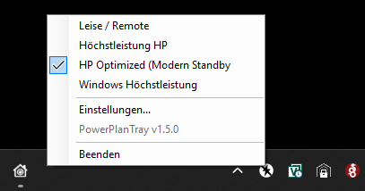
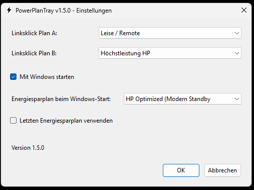

# PowerPlanTray

Minimalistisches Windows-Tray-Tool zum schnellen Umschalten zwischen vorhandenen Energieplänen unter Windows 11.

Version dieses Pull Requests: **1.6.0-beta.1**. Letzte stabile Version: **1.5.1**.

## Neu in 1.6.0-beta.1: App- und Zeitregeln

Über **App- und Zeitregeln…** im Tray oder in den Einstellungen lassen sich beliebige Programme und Zeitfenster einem Energieplan zuordnen. Beide Editionen enthalten diese Automatik. Es sind zunächst keine Regeln angelegt; ohne eigene Regeln ändert sich das bisherige Verhalten nicht.

### App läuft

- Beliebigen EXE-Dateinamen eingeben oder eine EXE über den Dateidialog auswählen.
- Die Regel gilt für alle laufenden Prozesse mit diesem Dateinamen, unabhängig vom Installationsordner. Groß-/Kleinschreibung und die Endung `.exe` spielen keine Rolle.
- **Startverzögerung**: Die App muss für die eingestellte Dauer durchgehend erkannt werden (0 = sofort).
- **Nachlaufzeit**: Nach Ende der App bleibt die Regel noch für die gewählte Dauer aktiv (0 = kein Nachlauf).
- Für eine VM den Prozess der laufenden virtuellen Maschine wählen, nicht nur das Verwaltungsfenster. Die Erkennung erfolgt über den frei gewählten Prozessnamen; ein VM-spezifischer Betriebszustand wird nicht abgefragt.

### Zeitfenster

- Wochentage, Startzeit und Endzeit frei wählen; es gilt die lokale Windows-Uhrzeit.
- Start inklusive, Ende exklusive. Start und Ende müssen unterschiedlich sein.
- Zeitfenster über Mitternacht gehören zum Starttag: Montag 22:00–06:00 endet am Dienstag um 06:00.
- Für einen ganzen Tag zwei aufeinanderfolgende Zeitfenster verwenden. Die Anwendung muss laufen; sie weckt den PC nicht auf.

### Priorität und manuelle Auswahl

- App- und Zeitregeln stehen in einer gemeinsamen Liste. Die **oberste passende, aktivierte Regel** gewinnt. **Nach oben / Nach unten** ändern die Priorität.
- Nicht mehr vorhandene Zielpläne werden übersprungen. Fehlgeschlagene Wechsel werden im Tray-Status gemeldet und beim nächsten Durchlauf erneut versucht.
- Sind keine Regeln mehr aktiv, wird der Energieplan vor Beginn der Automatik wiederhergestellt. Das gilt auch beim normalen Beenden.
- Manuelle Planwahl im Tray oder ein erkannter externer Planwechsel pausiert die Automatik. Fortsetzung über **Regeln jetzt fortsetzen** oder automatisch, sobald keine Regel mehr passt. Der manuell gewählte Plan wird dabei nicht zurückgesetzt.
- Globale Aktivierung und einzelne Regeln können ein-/ausgeschaltet werden. Änderungen im Regeldialog gelten erst nach **Speichern**.
- Prüfung alle fünf Sekunden. Verzögerung und Nachlauf beginnen beim ersten beobachteten Start bzw. Ende. Während der Regeldialog geöffnet ist, werden Planwechsel ausgesetzt.
- Regeln werden zusammen mit den bestehenden Einstellungen in `%APPDATA%\PowerPlanTray\settings.json` gespeichert. Der vorherige Plan wird für die laufende Programmsitzung gehalten; nach einem Absturz oder erzwungenen Beenden erfolgt keine nachträgliche Wiederherstellung.

### Beta-Downloads

- `PowerPlanTray-v1.6.0-beta.1.zip`: Standard, ohne Codex-Sitzungsüberwachung oder Standby-Sperre.
- `PowerPlanTray-v1.6.0-beta.1-Codex.zip`: mit optionalem Codex-Standby-Schutz wie in 1.5.1.

Beide Varianten sind portable, selbstständige Windows-x64-Anwendungen und werden aus demselben Commit gebaut. Vor einem Test die bisherige PowerPlanTray-Instanz beenden.

### Tests und Builds

```powershell
dotnet run --project tests/Rules.Tests.csproj -c Release
dotnet build PowerPlanTray.csproj -c Release -p:CodexEdition=false
dotnet build PowerPlanTray.csproj -c Release -p:CodexEdition=true
```

Die Regeltests prüfen unter anderem Zeitgrenzen, Mitternacht, Wochentage, Prioritäten, Startverzögerung, Nachlauf, manuelle Auswahl, Wiederherstellung und fehlgeschlagene Planwechsel ohne echte Systemänderungen.

## Funktionen

- Liest vorhandene Energiepläne dynamisch über `powercfg /list` ein
- Zeigt den aktuell aktiven Energieplan im Tray an
- Rechtsklick auf das Tray-Symbol: Energieplan direkt auswählen
- Linksklick auf das Tray-Symbol: zwischen zwei frei wählbaren Energieplänen umschalten
- Einstellungen werden unter `%APPDATA%\PowerPlanTray\settings.json` gespeichert
- Optionaler Autostart über **Mit Windows starten**
- Optionaler fester Energieplan beim Windows-Start
- Alternativ kann der zuletzt aktive Energieplan weiterverwendet werden
- Statusaktualisierung alle 5 Sekunden (ohne das geöffnete Menü neu aufzubauen)
- Optionaler Codex-Standby-Schutz: erkennt `task_started`, `task_complete` und `turn_aborted` in lokalen Codex-JSONL-Sitzungsprotokollen und verhindert den System-Standby während einer Aufgabe sowie während einer konfigurierbaren Nachlaufzeit (Standard: 15 Minuten; zunächst deaktiviert)
- Portable, selbstständige Single-EXE für Windows x64

## Energiepläne

PowerPlanTray übernimmt die auf dem jeweiligen Windows-System vorhandenen Energiepläne automatisch.

Zusätzlich wird **Windows Höchstleistung** immer als auswählbarer Eintrag angeboten. Dieser Eintrag verwendet intern den Windows-Alias:

`SCHEME_MIN`

Die bekannte Windows-GUID lautet:

`8c5e7fda-e8bf-4a96-9a85-a6e23a8c635c`

Dadurch kann der Windows-Höchstleistungsplan auch dann aktiviert werden, wenn er vorher nicht in `powercfg /list` angezeigt wird.

## Bedienung

### Linksklick

In den Einstellungen können zwei Energiepläne als **Plan A** und **Plan B** festgelegt werden. Ein Linksklick auf das Tray-Symbol wechselt direkt zwischen diesen beiden Plänen.

### Rechtsklick

Das Kontextmenü zeigt alle erkannten Energiepläne sowie **Windows Höchstleistung**. Der aktive Plan wird mit einem Haken markiert.



Zusätzlich stehen dort zur Verfügung:

- **Codex-Standby-Sperre aktivieren** (ein-/ausschalten)
- **Codex-Nachlaufzeit** (5, 10, 15, 30 oder 60 Minuten)
- **Codex-Status** (läuft / Nachlauf / normaler Standby)
- Einstellungen
- aktuelle Programmversion
- Beenden

## Einstellungen

Über **Einstellungen...** können folgende Optionen geändert werden:

- **Linksklick Plan A**
- **Linksklick Plan B**
- **Mit Windows starten**
- **Energiesparplan beim Windows-Start** – legt einen festen Energieplan fest, der beim Windows-Autostart aktiviert wird
- **Letzten Energiesparplan verwenden** – lässt den zuletzt aktiven Windows-Energieplan unverändert; die feste Startplan-Auswahl ist dann deaktiviert
- **Codex-Standby-Sperre aktivieren** – standardmäßig aus
- **Nachlaufzeit nach Codex-Aufgaben** – standardmäßig 15 Minuten



Der Autostart wird benutzerspezifisch unter folgendem Registry-Pfad verwaltet:

`HKCU\Software\Microsoft\Windows\CurrentVersion\Run`

Die Startplan-Logik wird nur beim Windows-Autostart von PowerPlanTray ausgeführt. Wird PowerPlanTray später manuell gestartet, wird der aktuellen Energieplan dadurch nicht verändert.

PowerPlanTray benötigt dafür keine Änderung an systemweiten Autostart-Einstellungen.

## Codex-Standby-Schutz (nur Codex-Edition)

Die optionale Funktion liest ausschließlich Ereignistypen und Zeitstempel aus `%USERPROFILE%\.codex\sessions\**\*.jsonl`. Prompt- und Antworttexte werden weder angezeigt noch gespeichert.

- Bei `event_msg / task_started` verhindert Windows den automatischen System-Standby.
- Bei `event_msg / task_complete` oder `event_msg / turn_aborted` beginnt die gewählte Nachlaufzeit.
- Eine neue Codex-Aufgabe unterbricht den Nachlauf; parallele Sitzungen werden berücksichtigt.
- Nach mehr als 90 Minuten ohne Protokollaktivität gilt eine angefangene Aufgabe als verwaist.
- Die Sperre betrifft nur den System-Standby; der Bildschirm darf sich weiterhin ausschalten.
- Deaktivierung oder Beenden von PowerPlanTray gibt die Sperre unmittelbar frei.
- Überprüfung unter Windows: `powercfg /requests`; bei aktivem Schutz sollte unter **SYSTEM** eine Anforderung von PowerPlanTray erscheinen.

Die Funktion kann keine manuell angeordnete Energiesparaktion verhindern; sie verhindert nur den automatischen Leerlauf-Standby. Wenn Codex sein Protokollformat ändert oder Sitzungsdateien nicht lesbar sind, lässt sich ein laufender Task unter Umständen nicht zuverlässig erkennen. Bei Protokollfehlern wird die Sperre vorsichtshalber aufgehoben.

Die Codex-Erweiterung verändert keine Energieplanparameter. Nutzer können sie jederzeit deaktivieren.

## Tray-Symbole

Die Energiepläne werden durch kompakte Tray-Symbole unterschieden:

- **Höchstleistung HP** – weißer Blitz im Kreis
- **Windows Höchstleistung** – derselbe Blitz in Rot
- **HP Optimized (Modern Standby)** – weißes Symbol mit durchgestrichenem Blitz
- **Leise / Remote** – weißes ZZZ-Symbol
- andere Energiepläne – neutrales Symbol

Das Anwendungs- und Einstellungsfenster verwendet weiterhin das normale PowerPlanTray-Blitzsymbol.

## Verhalten von PowerPlanTray

PowerPlanTray verändert beim normalen Umschalten **keine einzelnen Energieplaneinstellungen**. Ein ausgewählter Plan wird ausschließlich über

```text
powercfg /setactive <GUID oder Alias>
```

aktiviert.

Beim Windows-Autostart kann PowerPlanTray abhängig von der gewählten Einstellung entweder einen festgelegten Energieplan aktivieren oder den zuletzt aktiven Energieplan unverändert lassen.

Modern Standby und vorhandene Energieplanparameter werden vom Tool nicht verändert.

## Build

Voraussetzung für einen lokalen Build ist das .NET 8 SDK.

```powershell
dotnet publish -c Release -r win-x64 --self-contained true /p:PublishSingleFile=true /p:EnableCompressionInSingleFile=true
```

Die EXE liegt anschließend unter:

`bin/Release/net8.0-windows/win-x64/publish/PowerPlanTray.exe`

## GitHub Actions

Bei Änderungen auf dem Hauptbranch und in Pull Requests führt GitHub Actions die Regeltests aus und erstellt beide portablen Windows-x64-Editionen. Die versionierten ZIP-Dateien stehen anschließend unter **Artifacts** bereit. Die Standard-Edition wird mit `-p:CodexEdition=false`, die Codex-Edition mit `-p:CodexEdition=true` gebaut.

## Änderungen in 1.5.1

- Codex-Standby-Schutz während laufender Aufgaben mit konfigurierbarer Nachlaufzeit (Standard 15 Minuten)
- Option direkt im Tray-Menü und im Einstellungsfenster
- **Flackerfreies Kontextmenü:** Neuzeichnung nur beim Öffnen statt alle fünf Sekunden
- Tray-Symbol und Tooltip werden nur bei tatsächlicher Änderung aktualisiert
- Versionsnummern von App, Assembly und Windows-Datei auf 1.5.1 angehoben

## Änderungen in 1.5.0

- neuer auswählbarer **Energiesparplan beim Windows-Start**
- neue Option **Letzten Energiesparplan verwenden**
- feste Startplan-Auswahl wird deaktiviert, wenn der letzte Energieplan verwendet werden soll
- Startplan wird ausschließlich beim Windows-Autostart angewendet

## Änderungen in 1.4.2

- **Windows Höchstleistung** erhält zur eindeutigen Unterscheidung den vorhandenen Blitz in Rot
- **Höchstleistung HP** behält unverändert den weißen Blitz
- übrige Tray-Symbole bleiben unverändert

## Änderungen in 1.4.1

- eigenes PowerPlanTray-Anwendungssymbol für EXE und Einstellungsfenster
- korrekte Verarbeitung deutscher Energieplannamen und Umlaute aus `powercfg`

## Änderungen in 1.4.0

- dynamische Erkennung vorhandener Energiepläne
- frei wählbare Pläne für den Linksklick-Wechsel
- Einstellungsdialog
- Autostart-Option
- Versionsanzeige
- zusätzlicher Eintrag **Windows Höchstleistung** über `SCHEME_MIN`
